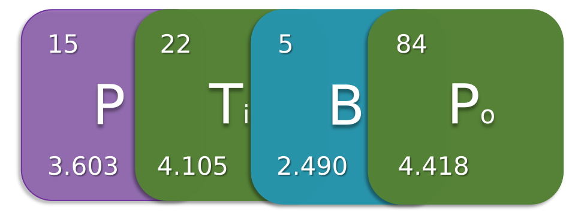
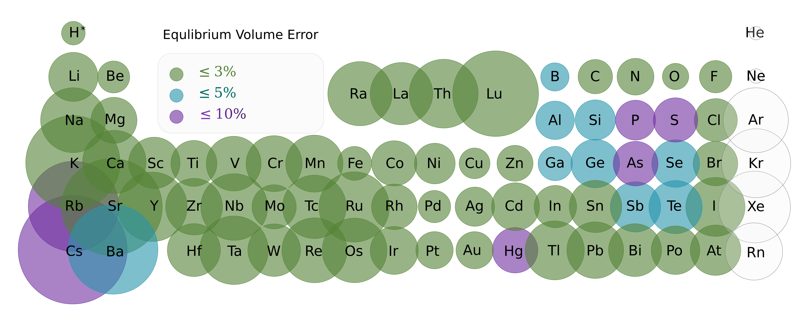

# The code for Density functional Tight-binding theory Parameterization: Periodic table baseline parameter set (PTBP)

<div align="center">

</div>

What does it include?
#### 1. Quick SKF file generator

<div style="background-color:#F8D7DA; padding:10px">
<strong>Tip:</strong>
SKF(Slater-Koster file) includes integral tables describing the Hamitonian and overlap matrix elements on an equidistant grid, where Hyperparmeters for confinement potential were embeded with the way of confinement pseudo-atomic orbitals.
</div>

For detail format of SKF, reference to [SlaterKosterFiles][1].
- [x] Generate skf files based on exists parameters (eg. [QUASINANO][2], [PTBP][3])
- [x] Generate skf files with your own parameters
- [x] Upload skf files to [https://zenodo.org/doi/10.5281/zenodo.10677795] [6]

#### 2. Parameterization (atomwise, comparing to pairwise)
- [x] Optimize parameters based on Loss: Energy & Geometry(the repetition of Paper [PTBP][3])
- [x] Optimize parameters based on Loss: Band structure (should be carefull to align the bands between DFTB and DFT `utils/calculator.py-delta_band_binary()`)
- [x] Optimize parameters based on Loss: Energy & Forces with datasets


## Installation

```bash
# In your conda env (e.g. `mpvasp`):

# 1. libxc C library + Python bindings — install from conda-forge.
#    `pip install pylibxc` alone fails because the underlying C lib is missing.
mamba install -c conda-forge libxc pylibxc

# 2. hotcent — not on PyPI, install editable from GitLab source.
#    Requires a C compiler (the package builds a small C extension `_hotcent`).
git clone https://gitlab.com/mvdb/hotcent
cd hotcent && pip install -e .

# 3. (Optional, only for --optimization_option) DFTB+ binary.
#    Pin to the nompi build to avoid pulling mpich/scalapack as dependencies.
mamba install -c conda-forge "dftbplus=25.1=nompi_*"

# 4. pydftb and PTBP — two packages from this repository; run from the repo root
#    (i.e. ptbp_lab/). pydftb (the DFTB engine in pydftb/) installs numpy, scipy, ase,
#    threadpoolctl and the `pydftb` command; PTBP depends on it, installs
#    scikit-optimize etc. and registers the `ptbp` command.
pip install ./pydftb .            # to work on the code: pip install -e ./pydftb -e .
#    pydftb's extras: "./pydftb[torch]" (PyTorch backend, GPUs, the loss gradient of
#    section 4e) and "./pydftb[dispersion]" (D3/D4), e.g.
#    pip install "./pydftb[torch]" .
```

pydftb also installs and works without PTBP (`pip install ./pydftb`; see `pydftb/README.md`). The old forms keep working: `python -m pydftb.validation.refgen --check` is `pydftb refgen --check`, `python tools/engine_parity.py ...` is `ptbp parity ...`, and a checkout runs without installing (`PYTHONPATH=.`).

Verified working combination (May 2026, macOS arm64, Python 3.11):
`ase 3.28.0`, `scikit-optimize 0.10.2`, `pylibxc 7.0.0`, `hotcent 2.0.1`,
`dftbplus 25.1` (nompi).
Also verified (October 2026, Linux x86_64, conda-forge, Python 3.11, with the two
packages installed as `pip install -e ./pydftb -e .`): `ase 3.29.0`,
`scikit-optimize 0.10.2`, `pylibxc 7.1.2`, `hotcent 2.1.0`, `dftbplus 25.1` (nompi),
`numpy 2.4.6`, `scipy 1.17.1`, optionally `torch 2.14.1` (CPU).

### Notes

- **`utils/_compat.py`** is loaded automatically on first import of `utils.*`
  or `cli.*`. It applies two compatibility shims at runtime:
  (a) forces `multiprocessing` to use the `fork` start method on macOS so the
  internal `mp.Pool` calls in `utils/hotpy.py` and `utils/loss.py` do not hang
  silently under `spawn`; (b) papers over the ASE 3.20+ extxyz refactor so
  `atoms.info['energy']` and `atoms.get_array('forces')` keep working on
  files written by the new ASE.
- **DFTB+ is only required for `--optimization_option`** (energygeometry /
  bandstructure / dataset / reaction). The `--skf_generator` paths only need
  hotcent + physrep + pylibxc.

### Quick smoke test (no DFTB+ needed)

```bash
mkdir -p /tmp/ptbp_test && cd /tmp/ptbp_test
ptbp --skf_generator full --symbols H O --known_parameters PTBP
# Generates H-H.skf, H-O.skf, O-H.skf, O-O.skf in the cwd.
```

---

## Quick start

After installing (see above), the toolkit exposes four main subcommands via the
`ptbp` console script (plus `ptbp parity` and `ptbp plan`, sections 4b and 4c):

```bash
ptbp setup                                  # Interactive TUI wizard (start here if unsure)
ptbp gen H O                                # Generate H/O Slater-Koster files
ptbp optimize my_data.xyz                   # Auto-detect mode + run BO
ptbp postprocess run_2026-05-05_22-30/      # Re-emit plots from a prior run
```

Don't know what flags or values to pass? Run `ptbp setup` — it walks
you through dataset selection, validates the file (formula count,
energy/force presence, auto-detected mode), and lets you pick the
optimiser / E0s / advanced knobs through a multi-step terminal wizard
(works over plain SSH, no X-forwarding required). At the end it writes
a reproducible `ptbp_run.yaml` and prints the equivalent
`ptbp optimize ...` command for you to run in your shell / tmux / SLURM.

Each subcommand has its own focused `--help`. Common one-liners:

```bash
# Generate SKFs for a list of elements using PTBP-published params
ptbp gen H O Cu --params PTBP

# Optimize on a flat dataset of structures-with-energies-and-forces.
# Auto-fits per-element E0s on first run, caches them, auto-detects the
# optimisation mode from the dataset shape, writes everything into
# ./run_<UTC-timestamp>/.
ptbp optimize trajectory.xyz

# Force a particular mode and use particle swarm
ptbp optimize trajectory.xyz --mode reaction --optimizer pso --n-particles 4 --n-calls 24

# Run from a YAML config, override one field on the CLI
ptbp optimize trajectory.xyz --config myrun.yaml --n-calls 30

# Re-do plotting / packaging from a finished run without rerunning the
# optimiser (reads <run_dir>/result.pkl + <run_dir>/ptbp_run.yaml)
ptbp postprocess run_2026-05-05_22-30/
```

`ptbp` also still accepts the original flat CLI (`--skf_generator ...` /
`--optimization_option ...`) — see the Legacy CLI appendix at the bottom.

---

## 1. SKF file generator

The skf_generator based on [Hotcent][4] and [Libxc][7] for bandstructure(H/S) part generation, and [Phyrep][5] for repulsive part generation.

[1]: https://dftb.org/fileadmin/DFTB/public/misc/slakoformat.pdf "Format of the v1.0 Slater-Koster files"
[2]: https://doi.org/10.1021/ct4004959 "DFTB Parameters for the Periodic Table: Part 1, Electronic Structure"
[3]: https://doi.org/10.1021/acs.jctc.4c00228 "Obtaining Robust Density Functional Tight Binding Parameters for Solids Across the Periodic Table"
[4]: https://gitlab.com/mvdb/hotcent "Hotcent Gitlab page"
[5]: https://gitlab.com/jmargraf/physrep "Physrep Gitlab page"
[6]: https://zenodo.org/records/10677796 "ParameterSets file"
[7]: https://www.tddft.org/programs/libxc/ "Libxc"
[8]: https://mncui.gitlab.io/mbook "mbook"


### 1. Generate from a published parameter set

```bash
ptbp gen C H O Cu --params PTBP
```

Equivalent legacy CLI (still supported):
```
python cli/run.py
--symbols C H O Cu
--skf_generator full
--known_parameters PTBP
```
- `--symbols`: for symbols
- `--skf_generator`: option for generating the `full` (bandenergy part + repulsive part), or only `band` or `rep` part.
- `--known_parameters`: option for generating parameters based on known_parameters `PTBP`, `QNplusRep` or `Prior`.
> `PTBP`: the general parameter set was shown in [PTBP][3] that aims to give robust description for solid states.

> `QNplusRep`: the parameter sets combined band energy part from [`QUASINANO2013`][2] and repulsive part that optimized in the same way as `PTBP`.

> `Prior`: use the empirical way to define the cutoff parameters with `r0_w=2*r_cov` and `r0_d=4*r_cov`, where `r_cov` means the covalent raduis, plus the repulsive part that optimized in the same way as `PTBP`.

> One can found the pre-generated SKF files correspondingly over [zendono][6]


### 2. One wants to generate skf files based on their own parameters
```
python cli/run.py 
--symbols C H O Cu 
--skf_generator full 
--confinement_parameters 3.0 5.0 2.0 3.0 5.0 2.0 3.0 5.0 2.0 3.0 5.0 2.0 
--repulsive_parameters 0.6 0.0 0.6 0.0 0.6 0.0 0.6 0.0
```
- `--confinement_parameters`: defines `r0_w`, `r0_d` and `p` values, respectively. In this example we simply assign same parameters (3.0, 5.0, 2.0) for each elements.

$$V_{conf} = \left( \frac{r_{cov}}{r^0} \right)^p$$
- `--repulsive_parameters`:defines `sigma_rep` and `kxc`, in this example we also simply assign same parameters (0.6, 0.0) for each elements. `kxc` was set to 0.0 defaultly in [PTBP][3], becuase it does not obviously affect the performance on Loss: Energy & Gemetries but burden the optimization process so much.


## 2. Parameterization
#### 1. Elementary

<strong>Tip:</strong>
Please check this [MBOOK][8] for the detail performance of each element!
</div>


Necessary preparations
- folders that contain the reference xyz file from DFT
- the arguments can be found in `cli/arg_parser.py`


```
ptbp --ref_dir dft \
    --results_dir   results \
    --dft_file      dft.xyz \
    --eos_file      fit.json \
    --eos_points    11 \
    --log_file      log.out \
    --para_file     par.out \
    --optimization_option   energygeometry \
    --parameters    r0_w r0_d sigma_rep \
    --superposition density                \
    --checkpoint    checkpoint.pkl \
    --xc            GGA_X_PBE+GGA_C_PBE \
    --kpt_density   5.0
```

- Where `dft` folder includes the reference file: `dft.xyz`, `fit.json`(which contains the Equation of state fitting results of reference dft), one can find the examples for `Cu` inside the dft folder.
- The parameters of each optimization step are stored inside `par.out`.
- `optimization_option`: defines different target loss. The four supported modes are documented below.
- `parameters`: specifies which parameter will be optimized, we use `r0_w, r0_d` and `sigma_rep` in our work.
- `xc`: defines the exchange correlation
- `kpt_density`: for DFTB calculation

### 3. Optimization modes

The same outer Bayesian optimisation loop drives every mode; what changes is
the loss function inside the inner `Repulsion_optimization` step.

Every loss except `bandstructure` is multiplied by a penalty on the confinement radii,
P = ((r0_w/(2 r_cov) − 1)² + 1)² · ((r0_d/(4 r_cov) − 1)² + 2)², which is smallest (4) at
r0_w = 2 r_cov, r0_d = 4 r_cov. r_cov is the covalent radius (Bohr) of the element being
parametrised: the heaviest element of the dataset, or the `--multi_element` element.
The published PTBP losses were computed this way. Until the fix described in
`pydftb/docs/index.html` (known issues), PTBP always used r_cov = 0.5 Bohr here, so loss
values of older runs are on a different scale (old skopt checkpoints are refused on resume;
convert them with `tools/rescale_checkpoint.py`).

| `--optimization_option` | Input shape | Loss | Required extras |
|---|---|---|---|
| `energygeometry` | An EOS scan of N phases × `--eos_points` volumes (i.e. `--eos_points 11` strict). | (½μ_V + ½μ_E)·P, Boltzmann-weighted over phases (μ_B is only logged; matches the original PTBP paper). | `--eos_file fit.json` (DFT EOS results) |
| `dataset` | Any ASE-readable trajectory (xyz, traj, …) of structures with DFT energies + forces. | (0.9·μ_E + 0.1·μ_F)·P, μ_E the sum over structures of the per-atom formation-energy error, μ_F the force MAE. | `--E0s '{"<Z>": <eV>, ...}'` (atomic ref energies as JSON dict) |
| `reaction` | Same as `dataset`, but the trajectory is expected to span multiple chemical formulas. | Identical to `dataset` plus a `reaction_per_formula.csv` written next to `par.out` reporting per-formula mean / max ΔE per atom. | `--E0s` (same as dataset) |
| `bandstructure` | A k-path band-structure reference. | HOMO/LUMO mismatch. | `--dft_band_file dft.json` |

#### Examples

```bash
# EOS mode (the original PTBP workflow):
ptbp --ref_dir dft --dft_file dft.xyz --eos_file fit.json --eos_points 11 \
     --optimization_option energygeometry \
     --parameters r0_w r0_d sigma_rep --superposition density

# Dataset mode (energy + forces on any trajectory):
ptbp --ref_dir dft --dft_file my_data.xyz \
     --optimization_option dataset \
     --parameters r0_w r0_d sigma_rep --superposition density \
     --E0s '{"6": -37.8, "1": -0.5}'

# Reaction mode (multi-formula dataset; same loss + per-formula breakdown):
ptbp --ref_dir dft --dft_file mixed_formulas.xyz \
     --optimization_option reaction \
     --parameters r0_w r0_d sigma_rep --superposition density \
     --E0s '{"6": -37.8, "1": -0.5, "8": -75.0}'
```

`--E0s` accepts a JSON dict keyed by atomic number; in `dataset` / `reaction`
mode the formation energy of each structure is computed as
`E_struct − Σ_Z E0[Z] · n_Z`, then aggregated into the loss.

#### Auto-fit E0s with on-disk cache

If you omit `--E0s` in `dataset` / `reaction` mode, PTBP first looks for a
cached fit at `<ref_dir>/E0s_dft.json`; if missing, it least-squares-fits
per-element E0s from the dataset's own `info['energy']` values
(solving E_total ≈ Σ_Z N_Z · E0[Z] across all structures) and writes the
result to that path. Subsequent runs reuse the cache for free, so the
typical workflow becomes:

```bash
# First run (no --E0s): auto-fit + cache
ptbp --ref_dir dft --dft_file my_data.xyz --optimization_option dataset \
     --parameters r0_w r0_d sigma_rep --superposition density

# Second run: cache hit, no refit
ptbp --ref_dir dft --dft_file my_data.xyz --optimization_option dataset \
     --parameters r0_w r0_d sigma_rep --superposition density
```

The fitted E0s are *self-consistent with the dataset* (the constant offset
cancels out of formation energies) but are not "true" isolated-atom
energies. If your dataset is dominated by one composition the fit is
ill-conditioned — you'll see a `WARNING: design matrix rank-deficient`
log line and should pass `--E0s` explicitly.

#### Other knobs

- `--n_calls N` — total Bayesian-optimisation iterations
  (defaults: 11 for energygeometry/dataset/reaction, 100 for bandstructure).
  In resume mode (see below) this is the number of *additional* iterations.
- **Smart BO seed**. When the dataset is a single element that has an
  entry in `utils.parameters_set.get_PTBP()`, PTBP starts the BO from
  the published `(r0_w, r0_d)` for that element instead of the
  `(3·r_cov, 5·r_cov)` heuristic. You'll see
  `BO seed from PTBP[<element>]: r0_w=..., r0_d=...` in the log.
  Multi-element datasets fall through to the heuristic seed.
- **Resume from checkpoint.** PTBP writes `checkpoint.pkl` (skopt
  `OptimizeResult` snapshot) after every BO iteration. On rerun in the
  same cwd, the file is automatically loaded:

  ```
  [checkpoint] Resuming from checkpoint.pkl: 11 prior iteration(s)
                loaded; will run 5 more (total stored: 16).
  ```

  Pass `--n_calls` to control how many additional iterations to run on
  top of what's stored. To force a cold start, delete `checkpoint.pkl`.
- **Confinement scheme (`--confinement`, three parameters per element).** Each element
  has three parameters: r0_w (wave-function confinement), r0_d (density confinement) and
  sigma_rep (repulsion). By default hotcent's confined atoms are solved self-consistently
  (`selfconsistent`, the default of hotcent 1.x, for which PTBP was written): r0_w shapes
  the orbitals and r0_d the density used for the two-centre integrals. hotcent >= 2.0
  defaults to a "perturbative" scheme in which r0_d has no effect when every valence
  subshell has a wave-function confinement, as in PTBP; runs before this change (M3, M4)
  used it, and `--confinement perturbative` (YAML key `confinement`) reproduces them,
  also when resuming their checkpoints. The scheme is printed at start-up and stored in
  `plan.json`. Details: `pydftb/docs/reports/M4e-r0d-confinement.html`.

### 4. Choosing the outer-loop optimiser

The same modes (`energygeometry` / `dataset` / `reaction` / `bandstructure`)
work with three different outer-loop optimisers, and the r0 modes also with two gradient
optimisers (section 4e):

| `--optimizer` | What it does | When to pick it | Library |
|---|---|---|---|
| `bo` (default) | Sequential Gaussian-process BO via skopt's `gp_minimize`. Strong sample efficiency, one evaluation at a time. | Few evaluations are expensive; you want the fewest possible. | `scikit-optimize` |
| `parallel_bo` | Skopt `Optimizer` with batched ask (`strategy='cl_min'`). `--n_particles` evaluations are proposed per round; with the L-mode wiring (Phase L below) they run concurrently in a fork pool. | Multi-core machine, want wall-clock speedup. | `scikit-optimize` |
| `pso` | Particle Swarm Optimisation via `pyswarms.single.GlobalBestPSO`. Population × iterations. | Loss surface is multi-modal / non-smooth, where GP assumptions break down. | `pyswarms` |
| `gradient` | Projected BFGS on the gradient of the loss (section 4e), from BO's seed. | Local refinement; sensitivity of the loss to r0. Needs `--engine pydftb` and torch. | `torch` |
| `bo_grad` | BO with `--n_calls`, then at most `--grad_maxiter` (default 5) gradient steps from its best point. | BO's global search plus a local finish. Needs `--engine pydftb` and torch. | `scikit-optimize`, `torch` |

```bash
# Default sequential GP-BO
ptbp ... --optimizer bo --n_calls 11

# Batched BO, 4-wide
ptbp ... --optimizer parallel_bo --n_particles 4 --n_calls 16

# Particle swarm, 4 particles for 5 iterations (= 20 evaluations)
ptbp ... --optimizer pso --n_particles 4 --n_calls 20
```

For PSO, `n_calls` is the total evaluation budget; iterations are derived
as `max(2, n_calls // n_particles)`. PSO returns a `result.pkl` with
the same `.x / .fun / .x_iters / .func_vals` shape as skopt, so all the
post-processing paths (convergence plot, best-folder copy, results.tgz)
just work.

### 4b. DFTB engine: DFTB+ or pydftb

Every DFTB calculation in the optimisation loop can run either in DFTB+ (through ASE, the default) or in **pydftb**, the in-process Python engine in `pydftb/`. pydftb has been validated against DFTB+; see `pydftb/README.md`. With PyTorch installed, pydftb also gives the derivatives of energies, charges and forces with respect to the Slater-Koster tables and the other parameters (`pydftb.autodiff`, checked against finite differences); PTBP uses them for the gradient of its loss (section 4e). Beyond what PTBP needs, pydftb is being completed to cover DFTB+'s other features (so far non-collinear spin, spin-orbit coupling, DFTB+U and onsite corrections, external electric fields, point charges for QM/MM embedding, implicit solvation, Casida excited states with their forces, XL-BOMD, DFTB+'s charge mixers, initial charges and spins, its charge restart files, fixed Fermi levels, independent k-point filling, the Hamiltonian's overrides (custom Hubbard U, reference occupations, truncated SK tables), the H5, halogen and dipole corrections, DFTB+'s analysis outputs (atom-resolved energies, net populations, CM5 charges, the electrostatic potential, eigenvec.out and band.out), Pipek-Mezey localised orbitals, bond populations and Mayer bond orders, Casida transition charges, an atom's shells taken from several Slater-Koster files (DFTB+'s SelectedShells), the polarisability (static and frequency-dependent) and response kernel of DFTB+'s coupled-perturbed response, coordinate derivatives and Born charges, and finite-difference Hessians with normal modes and their infrared and Raman intensities (DFTB+'s `SecondDerivatives` and `modes`); see `pydftb/docs/ROADMAP.md`). pydftb can also switch the atoms of one element smoothly between several parameter sets (type labels) according to each atom's coordination number, with forces and stress (`type_switching`, milestone M5a), which DFTB+ cannot; PTBP fits such types (M5b, section 4g).

```bash
ptbp optimize dft/dft.xyz --mode dataset --engine pydftb
```

What PTBP's DFTB+ runs actually compute is set by ASE's `ParserVersion = 1` input, which makes DFTB+ apply its legacy defaults. The pydftb engine reproduces these settings exactly:

| Setting | Value actually used |
|---|---|
| SCC | **shell-resolved** (DFTB+ injects `OrbitalResolvedSCC = Yes` for old parser versions) |
| Electronic filling | **Fermi at T = 0**: the historical `Fermi {2000 K}` / `MethfesselPaxton {Order 2}` keywords sit outside `Filling` and are silently ignored |
| H0/S derivatives | finite differences with a 0.01 Bohr step (legacy default) |
| Repulsive inside the loop | none (`PolynomialRepulsive = Yes` with zero coefficients; physrep adds it afterwards) |

On `dft/dft.xyz` the two engines agree to about 1e-9 eV in energy and 3e-6 eV/Å in forces.

Related options (also accepted as YAML keys):

| Flag | Meaning |
|---|---|
| `--engine {dftbplus,pydftb}` | Engine to use (default `dftbplus`). |
| `--smearing {none,fermi,gaussian,mp}` | Electronic smearing that really takes effect in both engines. `none` (default) keeps PTBP's historical behaviour (T = 0). For DFTB+, the `Filling` block is written correctly and the filling DFTB+ actually used is checked after every run. |
| `--smearing-temperature K`, `--mp-order N` | Temperature (default 2000 K) and Methfessel-Paxton order (default 2). |
| `--pydftb-forces {dftbplus,exact}` | `dftbplus` (default) reproduces DFTB+'s 0.01 Bohr finite-difference forces; `exact` uses exact derivatives. |
| `--pydftb-backend {numpy,torch}`, `--device`, `--dtype` | pydftb on PyTorch, on the CPU or a GPU (section 4f). |

To check the two engines against each other on your own dataset, run `ptbp parity DATASET --workdir DIR` (in a checkout also `python tools/engine_parity.py`), which evaluates the real loss at fixed parameter points.

### 4c. Several cores: `--ncores` and `ptbp plan`

Every BO step generates the Slater-Koster tables (hotcent), runs one DFTB calculation per structure and fits the repulsion (physrep). By default (`--ncores auto`) PTBP uses every core the process may use: the smallest of the CPU affinity, the cgroup CPU quota (containers), `SLURM_CPUS_PER_TASK` and the environment variable `PTBP_NCORES`. `--ncores N` sets a smaller budget and `--ncores 1` runs serially (YAML key `ncores`; the setup wizard asks for it on its advanced page). At start-up PTBP prints its plan, with estimated times, and saves it as `plan.json` in the run folder:

```
[plan] 4 cores (CPU affinity 4); engine pydftb; optimizer bo
[plan]   DFTB: 4 processes x 1 k-point thread, largest first -- 66 structures >= 4 cores: a process per core, the structures handed out largest first
[plan]   hotcent: 4 processes x 1 thread -- each table once, its rows shared by the processes
[plan]   physrep: serial -- vectorised, in this process
[plan]   estimated BO step: hotcent 4.2 s + dftb 11.2 s + physrep 12.1 s + other 1.0 s = 28.5 s
[plan]   estimated run: 11 BO points, about 5.2 min
[plan]   memory: up to 153 MB per DFTB process (12.5 GB available)
[plan]   suggestion: throughput: 4 BO points at a time on 1 core each (--optimizer parallel_bo --n-particles 4) would take about 17 s per point instead of 28 s; batched BO proposes points differently, so the optimisation path changes
```

After every BO step it prints the measured stage times next to the estimates (`[plan] BO step: hotcent 4.6 s (estimated 4.2 s), dftb ...`). `ptbp plan DATASET` shows the same without running anything, plus statistics of the dataset; it takes the options of `ptbp optimize` (`--mode --engine --kpts --eos-points --optimizer --n-particles --n-calls --ncores --multi-element`) and `--json`.

- **How the plan is chosen.** A cost model (`pydftb/perfmodel.py`) estimates the time and peak memory of every structure from its orbitals, k-points and the atom pairs within the Slater-Koster and Coulomb cut-offs. The recommender (`utils/recommender.py`) simulates the largest-first schedule for every split of the cores into processes × threads, drops the splits whose processes would not fit in the available memory (with a safety factor of 1.5) and takes the fastest. From the second BO step on, the structures are handed out by their measured times. On `dft/dft.xyz` the estimated BO step is within 2–4 % of the measured one (both engines, 1 and 4 cores).
- **Threads only where they help.** With fewer structures than cores the spare cores become pydftb k-point threads, but not for Gamma-only structures (there are no k-points to split). DFTB+ gets OpenMP threads only when every structure has at least 500 orbitals: on smaller matrices threads make DFTB+ slower (3.3× slower with 4 threads on a 4-atom Cu cell).
- **Memory.** In periodic cells the SCC Coulomb sum reaches as far as the smallest Hubbard U requires (96 Bohr for the 4p shell of Cu), so a cell of 64 Cu atoms needs about 2.2 GB in pydftb (0.3 GB in DFTB+). The plan runs fewer processes when they would not fit.
- **Results do not depend on the plan.** Only settings that leave every number unchanged are chosen automatically: `dft_final.xyz`, `dftb_band.xyz`, `search_index.txt`, the SKF files and the losses are byte-identical to a serial run, and pydftb's k-point threads give bitwise identical numbers. DFTB+ is reproducible at a fixed number of OpenMP threads, which the plan sets for every run (without a plan, i.e. in library use, DFTB+ uses all cores, as before).
- **Suggestions are only printed:** `--optimizer parallel_bo` when evaluating several BO points side by side gives more points per hour (it changes the optimisation path); `PTBP_BLAS_THREADS=N` (pydftb) for large Gamma-only cells with idle cores (results then differ in the last bits); the other engine when it would be much faster for the dataset (pydftb on small cells, DFTB+ on cells of tens of atoms).
- `ptbp plan --probe` measures this machine's speed relative to the calibration machine (about 0.7 s, cached per machine in `~/.cache/ptbp/probe.json`); later estimates use the cached value.
- In a parallel step every DFTB+ run gets its own folder `dftb_tasks/sNNNN/` in the step folder; it is removed after a successful run and kept after a failure.
- `PTBP_BACKEND=serial` forces serial execution (debugging); systems other than Linux run serially. `PTBP_HOTCENT_REFERENCE=1` and `PTBP_PHYSREP_REFERENCE=1` select the original hotcent driver and repulsion loop.

`ptbp parity DATASET --compare-serial` evaluates the loss with one core and with all of them, checks that the loss and the step's files are identical and prints the measured stage times next to the estimates. Design and measurements: `pydftb/docs/design/M3a-dispatch.html`, `M3b-hotcent-physrep.html`, `M3c-recommender.html` and the matching reports in `pydftb/docs/reports/`.

### 4d. DFTB+ configuration advisor

With the DFTB+ engine, PTBP checks the first DFTB+ run of every optimisation (and every DFTB+ run that fails) with the DFTB+ configuration advisor and prints what it finds with an `[advisor]` prefix; the findings also go to `advisor.json` in the run folder. It only reports: no setting is changed and the results are byte-identical. On PTBP's historical input (`--smearing none`) it reports that DFTB+ converts the input from parser version 1 (shell-resolved SCC, H and S differentiated with a 0.01 Bohr step) and ignores the `Fermi`/`MethfesselPaxton` blocks written outside `Filling` (the calculation runs at T = 0); these are marked as expected, since the published parameters were fitted that way. `PTBP_ADVISOR=0` turns the check off; `pydftb advisor RUN_DIR` checks any DFTB+ run directory by hand. Details: `pydftb/docs/reports/M3d-advisor.html`.

### 4e. Gradient of the loss: `--optimizer gradient` / `bo_grad`

With `--engine pydftb` and PyTorch installed, PTBP can compute the derivative of the loss
with respect to the confinement radii r0_w and r0_d (milestone M4c):

```bash
ptbp optimize dft/dft.xyz --mode energygeometry --engine pydftb --optimizer gradient --grad-maxiter 20
ptbp optimize dft/dft.xyz --mode dataset --engine pydftb --optimizer bo_grad --n-calls 11 --grad-maxiter 5
```

- **How**: hotcent cannot be differentiated, so the change of the SKF tables with r0 is a
  central difference of hotcent runs at r0 +- h (`--hotcent-fd-step`, default 0.04 Bohr for
  r0_w); pydftb's automatic differentiation gives the derivative of every DFTB energy (and,
  in the dataset/reaction modes, of the forces) with respect to the tables; the loss itself
  is differentiated analytically (absolute values, the Birch-Murnaghan fits by the implicit
  function theorem, the penalty).  The inner search over sigma_rep is handled with the
  envelope theorem, including minima on a kink of the loss and on the search bounds.
- **What does not change**: the loss value and every file of a step are bit for bit those
  of a plain step (the gradient work runs alongside); the default optimiser is still BO.
  Gradient evaluations use directories `results/opt_<r0_w>_<r0_d>` with six decimals, and
  each one adds a line to `grad.out` (value, both derivatives, sigma_rep, timings).
- **Cost**: one value + gradient costs about 1.4 BO steps in the energygeometry mode and
  2.6 in the dataset mode (Cu, 4 cores: 38 s vs 27 s, 41 s vs 16 s): two or three extra
  hotcent runs, and in the dataset mode a second DFTB pass for the forces.
- **Benchmark** (Cu, 4 cores): in the energygeometry mode the gradient optimiser brought the
  loss from 1.899 to 0.760 in 635 s; the best of three 11-call BO runs reached 0.855, and BO
  given the same time did not improve on its seed.  In the dataset mode the two tied (209.9
  vs 208.5).  Note that PTBP's default BO (`--n_calls 11`) evaluates the seed plus 10 random
  points (skopt's default `n_initial_points` is 10): the Gaussian process never picks one.
- **Result**: as with BO, the lowest loss evaluated (failed steps, whose loss is 97-99,
  excluded).  An evaluation without a gradient (a failed step, or an SCC that did not
  converge in 1000 iterations, which happens for metals at T = 0) still counts for the
  result, but the optimiser treats it as a rejected step.
- **Caveats**: hotcent's numerical noise makes the derivative uncertain by 1-3 %.  With
  hotcent 2.1 (perturbative confinement, every valence subshell confined), r0_d does not
  change the SKF files at all, so the loss depends on r0_d only through the penalty, whose
  minimum is at r0_d = 4 r_cov.  The loss can jump (an equation-of-state fit that leaves
  the sampled volumes, the sigma_rep search switching branch); the optimiser treats such
  points as rejected steps.  `ptbp plan` still estimates the time of BO steps.  See
  `pydftb/docs/reports/M4c-ptbp-gradient.html`.

### 4f. pydftb on PyTorch and GPUs: `--pydftb-backend`, `--device`, `--dtype`

With `--engine pydftb`, the SCC linear algebra (k-point matrices, Cholesky factor, eigensolver,
density matrices) can run on PyTorch, on the CPU or on a GPU (milestones M4a and M4d):

```bash
pydftb gpu-check --json gpu_check.json                           # check the GPU first
ptbp optimize dft/dft.xyz --engine pydftb --pydftb-backend torch --device cuda
ptbp optimize dft/dft.xyz --engine pydftb --pydftb-backend torch --device mps --dtype float32
```

| Flag (YAML key) | Values | Default |
|---|---|---|
| `--pydftb-backend` (`pydftb_backend`) | `numpy`, `torch` | `numpy` |
| `--device` (`device`) | `cpu`, `auto`, `cuda`, `cuda:1`, `mps`, `xpu` | `cpu` |
| `--dtype` (`dtype`) | `float64`, `float32` | `float64` |

- **The defaults change nothing**: NumPy on the CPU in float64, every number and file as
  before.  `--device` other than `cpu` and `--dtype float32` need `--pydftb-backend torch`.
- **On a GPU the DFTB stage runs in the main process, one structure after the other** (a
  process that has used CUDA should not hand CUDA work to forked workers); the other stages
  still use every core.  A GPU therefore pays only if it computes the structures faster
  than the CPU processes do side by side, which `gpu_check` measures on your machine (its
  Cu timings).  PTBP refuses a GPU with `--optimizer parallel_bo` or `pso`, and the gradient
  optimisers (section 4e) use the NumPy backend only.
- **torch on the CPU** runs like NumPy (one process per core, one torch thread each).  Its
  results agree with NumPy to about 1e-13, not bit for bit (MKL vs OpenBLAS).
- **Devices**: NVIDIA and AMD GPUs are `cuda` (AMD with a ROCm build of torch).  Apple's
  `mps` has no float64, so it needs `--dtype float32` and its float64 parts run on the CPU.
  On `mps` and Intel's `xpu`, Cholesky and eigh run on the CPU unless a probe at first use
  shows they work on the device.  On CUDA pydftb uses torch's deterministic algorithms
  while it computes, so a run is reproducible on the same machine; GPU and CPU agree to
  about 1e-12 (float64), not bit for bit.
- `--device auto` looks for a GPU in a subprocess (the main process does not initialise
  CUDA) and prints what it picked.  `plan.json` records the backend, device, precision and
  torch version; on a GPU the DFTB stage has no time estimate.  With the NumPy backend on a
  machine with a GPU, the plan prints a suggestion (also `ptbp plan --probe`); it is never
  applied.
- **Not measured here**: the development machine has no GPU, so every GPU number is still
  "not measured".  Please send the JSON written by `gpu_check` back.  float32 is not
  advisable for the forces of metals at T = 0.  Details:
  `pydftb/docs/reports/M4d-devices.html`.

### 4g. Parameters per element and per type (M5b)

A dataset with several elements gets **one set of (r0_w, r0_d, σ_rep) per element** by
default (the optimisers search 2N radii; σ_rep is searched per set inside every step).
Before M5b PTBP gave all elements one shared set: `--shared-parameters` reproduces that
byte for byte, and a single element (Cu) is unchanged. Results of multi-element datasets
therefore differ from those of earlier versions.

```bash
ptbp optimize data.xyz                          # one set per element (default)
ptbp optimize data.xyz --shared-parameters      # one set for all elements (before M5b)
ptbp optimize cuo.xyz --multi-element Cu        # fit Cu only; O keeps PTBP's published parameters
ptbp optimize cu.xyz --mode energygeometry --engine pydftb \
     --switch Cu Cu2,Cu 11.0 1.0                # two Cu types switched by coordination number
ptbp optimize data.xyz --type-start N 2.4 3.6   # start of one type's radii (Bohr)
```

- Several types of one element (`--switch`, or `types:` in the YAML config) use pydftb's
  smooth type switching (M5a) and need `--engine pydftb` with the NumPy backend.
- The penalty is the geometric mean of the parameter sets' penalties.
- Gradient optimisers work with one set per element (2N directions), not with switched types.
- Details: `pydftb/docs/reports/M5b-ptbp-types.html`.

### 5. `--postprocess_only`: skip the optimisation, redo just the plots

After every successful run PTBP snapshots the optimisation outcome to
`./result.pkl`. `--postprocess_only` skips `loss.optimize()` entirely and
loads that snapshot, taking seconds rather than minutes/hours:

```bash
# First run (writes ./result.pkl on completion)
ptbp ... --optimizer pso --n_calls 20

# Bug in plotting code? Want to repackage results.tgz? Rerun
# post-processing instantly without redoing 20 PSO evaluations:
ptbp ... --optimizer pso --n_calls 20 --postprocess_only
```

This was specifically built so that a long PSO/BO run isn't wasted when
something downstream of the optimiser fails. The other CLI args still
need to be passed (so we can locate the dft directory etc.) but the
optimiser settings are ignored — only `result.pkl` is read.

### 6. Acknowledgement
The authors gratefully acknowledge Noam Bernstein for providing the initial geometries of the homoelemental crystals and Maxime Van den Bossche for support with the hotcent package. Furthermore, we respectfully thank the works from Thomas Heine's group that initially inspired our work, and the developers of DFTB+ who made our DFTB calculations conveniently possible.


## License

PTBPlab, including the `pydftb` engine, is released under the [MIT License](LICENSE).

The MIT License covers the code in this repository. The packages it works with keep their own licenses and are not distributed here:

| Package | License | How PTBPlab uses it |
|---|---|---|
| [hotcent](https://gitlab.com/mvdb/hotcent) | GPL-3.0 | imported at run time to generate SKF files |
| [DFTB+](https://dftbplus.org) | LGPL-3.0-or-later | separate program, run as an external executable |
| [ASE](https://wiki.fysik.dtu.dk/ase/) | LGPL-2.1-or-later | imported at run time |
| [libxc / pylibxc](https://libxc.gitlab.io) | MPL-2.0 | used by hotcent |
| [s-dftd3](https://github.com/dftd3/simple-dftd3), [dftd4](https://github.com/dftd4/dftd4) (optional) | LGPL-3.0-or-later | imported at run time for D3/D4 dispersion in `pydftb` |

If you redistribute PTBPlab bundled with any of these packages, their license terms apply to that bundle.

`pydftb` is written from the published equations and contains no code copied from DFTB+ or the other packages above. Where it reproduces DFTB+ behaviour, its documentation names the DFTB+ source file for reference only.

---

## Appendix: Legacy CLI (deprecated)

The original flat CLI from before the subcommand redesign still works.
Every example in the upper sections has an equivalent flat-CLI form, and
existing user scripts are unchanged. A one-line note is printed to
stderr whenever the legacy entry is hit so users know there is a
friendlier surface available now.

| New subcommand | Legacy equivalent |
|---|---|
| `ptbp gen H O --params PTBP` | `ptbp --skf_generator full --symbols H O --known_parameters PTBP` |
| `ptbp optimize my.xyz --mode dataset --n-calls 30` | `ptbp --optimization_option dataset --ref_dir <parent> --dft_file my.xyz --n_calls 30 --parameters r0_w r0_d sigma_rep --superposition density --xc GGA_X_PBE+GGA_C_PBE --kpt_density 5.0` |
| `ptbp postprocess run_dir/` | `(cd run_dir && ptbp --optimization_option dataset --ref_dir dft --dft_file dft.xyz --postprocess_only ...)` |

The legacy CLI does NOT support `--output` (it always writes to cwd) or
`--config` (no YAML), so prefer the new subcommands for new work. The
legacy will be removed in a future major release.


