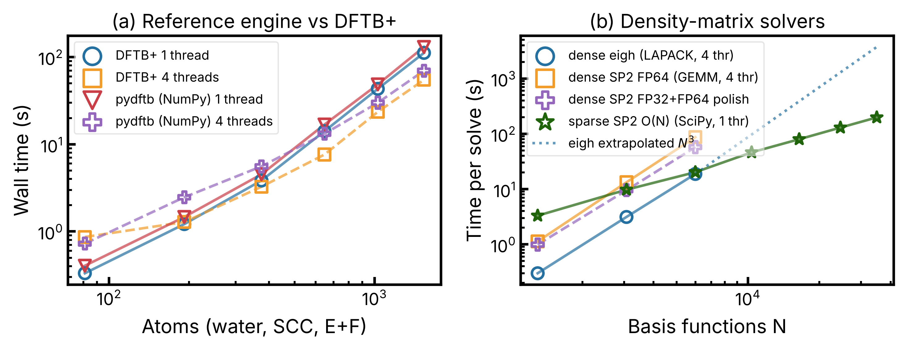

# 从零实现 DFTB：调研与实验报告（通俗版）

> 分支：`claude/inspiring-ride-zax2o7` ・ 代码目录：`pydftb/` ・ 日期：2026-10-19
> 测试机器：云端 4 核 CPU、15 GB 内存，没有 GPU。对照程序是 DFTB+ 25.x。
> 每个数字后面都标了来源：
> - **[实测]**：本次在这台机器上跑出来的；
> - **[文献]**：别人论文或手册里的数据，已核对出处，见文末；
> - **[估计]**：推算出来的，还需要上 GPU 或集群验证。
>
> 第一次出现的专业词都会顺手解释；集中的解释放在文末「名词小词典」。
>
> **2026-10-20 更正（M1 阶段核实后）：**
> 1. PTBP 代码里写的「2000 K、MP 2 阶展宽」从未生效：ASE 把这两个关键字写在 `Filling` 之外，被 DFTB+ 静默忽略，实际是 T = 0。本报告中「PTBP 目前在用 MP 展宽」的说法是错的。
> 2. PTBP 经 ASE 调用 DFTB+ 时，输入格式版本为 1，DFTB+ 会自动启用**按壳层分辨的 SCC**，并且力用 0.01 Bohr 的有限差分计算。
> 3. 第三节第 4 小节的吞吐测试用的不是 PTBP 的真实设置。按真实设置的复测见 `docs/reports/M1-ptbp-integration.html`。
>
> 详见 `docs/design/M1-ptbp-integration.html`。

---

## 一、先说结论（五句话）

1. **第一种思路「能跑」已经做出来了。** 用 Python 从零写了一个 DFTB 程序 `pydftb`。在 8 个测试体系上，它算出的能量、原子受力、原子电荷都和 DFTB+ 一致：
   - 能量至少前 6 位有效数字相同，差异 < 4×10⁻⁶ eV；
   - 受力差异 < 6×10⁻⁵ eV/Å；
   - 测试体系包括分子、含铜的团簇、铜晶体、水盒子。
   - 速度和 DFTB+ 差不多，只慢 10–30 %。
2. **第二种思路「疯狂加速」可行，但重点不在「换语言重写」。** 加速要靠三件事：
   - **换算法**：不再做最耗时的那一步「矩阵对角化」；
   - **换硬件**：用 GPU；
   - **换用法**：一次算一批结构，不再一个一个地调外部程序。
   - 实测：17,496 个原子的水，新算法单核约 230 秒；老算法估计要约 1 小时。
3. **DFTB+ 加节点不加速，原因基本找到了，不算「原因不明」。** 400 原子这个规模，80 % 的时间耗在一次矩阵对角化上。矩阵太小，拆到多台机器上，各台机器之间的通信时间比计算时间还长。另外本机实测到一个很容易踩的配置坑：线程数设错会让 DFTB+ **慢 12 倍**（第四节）。
4. **对 PTBP 参数化，光靠「不再反复调用 DFTB+」是不够的。** 实测 DFTB+ 每次启动加读写文件只要约 0.03 秒，`pydftb` 在 PTBP 的铜数据集上与 DFTB+ 速度持平（第三节第 4 小节）。真正的收益要靠另外两件事：
   - GPU 批量计算；
   - 「自动求导」：直接算出「误差对参数的梯度」，用梯度优化取代贝叶斯优化里的盲试，减少要试的参数组数。
5. **建议路线**是一套代码分两层：
   - 上层：好读的 Python 物理公式（已完成）；
   - 下层：可替换的计算引擎，从 CPU 逐步换到 GPU，再到多机。
   - 「DFTB+ 全部功能」工作量大，要分阶段做，第六节有清单和工作量估计。

---

## 二、思路一「能跑」：做了什么、对得上吗

### 2.1 DFTB 计算是怎么一步步算的（以及每步对应哪个文件）

| 步骤 | 通俗解释 | 文件 |
|---|---|---|
| ① 读参数表 | SKF 文件里存着「两个原子相距 r 时，电子在它们之间跳的难易程度」的数值表。程序先读进来，再在表格点之间插值。插值方式和 DFTB+ 完全一样。 | `skf.py` |
| ② 找邻居 | 找出每个原子周围一定距离内的所有原子；晶体要考虑周期性复制出来的「镜像原子」。 | `neighbors.py` |
| ③ 搭矩阵 | 对每一对邻居，按两原子连线的方向把表里的数「转」到实验室坐标系（这一步叫 Slater-Koster 变换），拼成两个大矩阵 H 和 S。 | `slako.py`, `hamiltonian.py` |
| ④ 解方程 | 对矩阵 H、S 求解，得到电子能级和电子在各原子上的分布。这是**最耗时**的一步，叫「对角化」。 | `solvers.py` |
| ⑤ 电荷自洽 | 电子分布会改变电荷，电荷又反过来影响 H。所以要反复做 ④，直到电荷不再变化，这个过程叫 SCC，一般 10–20 轮。晶体里的远程静电力用 Ewald 求和处理。 | `coulomb.py`, `mixer.py` |
| ⑥ 能量和受力 | 收敛后算总能量和每个原子受的力。 | `calculator.py` |

另外几个文件：

- `ase_calc.py`：可以直接替换 PTBP 里现在用的 ASE `Dftb` 计算器。
- `tests/test_pydftb.py`：自动化测试。
- `bench/`：所有实验脚本和原始数据。

### 2.2 和 DFTB+ 对答案 [实测]

脚本是 `bench/validate.py`。SKF 参数用本仓库现场生成，铜含 d 轨道：`ptbp gen H C O Cu --params PTBP`。

| 测试体系 | 原子数 | 能量差 | 最大受力差 | 最大电荷差 |
|---|---|---|---|---|
| 水分子 | 3 | 5×10⁻¹⁰ eV | 6×10⁻⁵ eV/Å ※ | 1×10⁻⁹ e |
| 甲醇分子 | 6 | 3×10⁻¹⁰ eV | 7×10⁻⁷ eV/Å | 5×10⁻⁹ e |
| 4 个铜原子 + CO（含 d 轨道） | 6 | 9×10⁻⁸ eV | 8×10⁻⁷ eV/Å | 6×10⁻⁹ e |
| 同上，每个轨道单独算电荷 | 6 | 5×10⁻⁷ eV | 8×10⁻⁷ eV/Å | 2×10⁻⁸ e |
| 铜晶体，1 原子，216 个 k 点 | 1 | 2×10⁻⁸ eV | — | ≈0 |
| 变形的 8 原子铜晶体，75 个 k 点 | 8 | 2×10⁻⁷ eV | 2×10⁻⁵ eV/Å | 7×10⁻⁹ e |
| 水盒子，周期性 | 24 | 4×10⁻⁶ eV | 2×10⁻⁶ eV/Å | 2×10⁻⁷ e |
| CuO 链，16 个 k 点 | 4 | 3×10⁻⁷ eV | 5×10⁻⁷ eV/Å | 5×10⁻⁸ e |

- 「k 点」是晶体计算里对晶格周期性采样的点，点越多越精确，也越慢。
- 拿一个尺度来对照：DFTB 本身相对 DFT 的误差通常在 0.01–0.1 eV/原子。表里的差异比这小一千倍以上，可以认为**两个程序的答案完全相同**。
- ※ 水分子受力差稍大，是 DFTB+ 自己的近似造成的：它用「数值差分」求导数。`pydftb` 用解析精确的方法，和「把原子挪一点点、看能量怎么变」的直接检验相比，误差只有 1.5×10⁻⁷ eV/Å。

### 2.3 写的过程中搞清楚的几个细节（DFTB+ 文档里没写明）

- 不分轨道算电荷时，DFTB+ 用 **s 轨道的 Hubbard U**（描述「原子多一个电子要付出多少能量」的参数）代表整个原子，而不是最外层轨道的 U。用错的话，水分子能量差 0.3 eV。
- DFTB+ 内部的单位换算是老版本常数：1 Bohr = 0.529177249 Å，1 Hartree = 27.2113845 eV。与 ASE 略有不同，对比时必须统一。

### 2.4 难度判断

- **核心计算的风险低。** 从零写到和 DFTB+ 逐项对齐，含调试，在一个工作会话里就完成了。程序约 1100 行 Python，不含测试和实验脚本。
- 真正的工作量在两块：一是「全功能」，见第六节；二是工程化，包括输入格式、断点续算、结构优化和分子动力学驱动、报错提示、文档。

---

## 三、加速实验

### 3.1 时间都花在哪了 [实测]（水盒子，含电荷自洽和受力）

| 原子数 | pydftb 单核总时间（其中：搭矩阵 / 静电 / **对角化** / 受力） | pydftb 4 核 | DFTB+ 单核 | DFTB+ 4 核 |
|---|---|---|---|---|
| 375 | 4.5 s（1.4 / 0.9 / **1.7** / 0.3） | 5.6 s | 3.8 s | 3.3 s |
| 648 | 16.8 s（3.0 / 2.5 / **8.7** / 1.0） | 13.2 s | 14.1 s | 7.6 s |
| 1029 | 48.5 s（4.7 / 5.2 / **30.6** / 2.4） | 29.9 s | 43.2 s | 23.5 s |
| 1536 | 130 s（8.4 / 10.9 / **88.0** / 4.9） | 69.7 s | 112 s | 54.8 s |



左图：两个程序的耗时几乎重合。右图：不同「解方程」方法的耗时，下面几节解释。

- **对角化占了大头。** DFTB+ 自带的计时也是这样：1029 原子时，对角化占 78 %。
- 用 4 核只快了约 2 倍。原因是对角化这种运算本身很难切成小块并行。
- 换句话说，**只要还用对角化，用哪种语言重写都快不起来。** 要加速，就得换掉这一步。

### 3.2 换算法：用「矩阵乘法」代替「对角化」 [实测]

- **原理。** 有一种叫 SP2 的方法，只需要把矩阵反复自乘约 20 次，就能得到和对角化一样的结果。
- **好处。** 矩阵乘法是 GPU 最擅长的运算，GPU 上专门的「张量核心」做乘法极快。
- **再进一步。** 前 18 次左右用低精度（FP32，单精度，约 7 位有效数字，速度翻倍），最后 2 步用高精度（FP64，双精度，约 16 位有效数字）修正。这叫「混合精度」。

| 矩阵大小 N | 对角化（4 核） | SP2 全高精度 | SP2 混合精度 | 混合精度带来的能量误差 |
|---|---|---|---|---|
| 1296 | 0.30 s | 0.83 s | 0.69 s | 3×10⁻¹² eV/原子 |
| 3072 | 3.1 s | 10.3 s | 6.5 s | 2×10⁻¹² eV/原子 |
| 6000 | 18.8 s | 70 s | 41 s | 2×10⁻¹² eV/原子 |

（N 是「基函数个数」，约等于原子数 × 每个原子的轨道数，水约为原子数的 2 倍。N 决定矩阵有多大。）

- **在 CPU 上 SP2 反而慢 3–4 倍。** 这是预料之中的：CPU 做矩阵乘法并不特别快。
- **它的意义在 GPU 上。** 混合精度几乎不损失精度，误差小到可以忽略。
- 别人在 A100 GPU 上的实测：N=19,020 时，SP2 用 3–7 秒，GPU 上的标准对角化用 14.7 秒 [文献 T2]。
- [估计] A100 做矩阵乘法约是本机的 100 倍。N=6000 时 SP2 大约 0.5 秒，本机对角化要 18.8 秒。

### 3.3 换算法：只算「有用的」部分，计算量随原子数线性增长 [实测]

- **原理。** 对绝缘体（比如水），远处原子之间的电子关联几乎为零，矩阵里绝大部分数接近 0。只存、只算那些不为 0 的数，叫「稀疏矩阵」。
- **好处。** 计算量随原子数**线性增长**，即「线性标度」：原子多 10 倍，时间也只多 10 倍。对角化则是原子多 10 倍，时间多 **1000 倍**。

| 原子数 | N | 稀疏 SP2 总时间（单核，含搭矩阵） | 对角化（4 核） | 每行非零数 | 能量误差 |
|---|---|---|---|---|---|
| 1536 | 3072 | 12 s | 4.1 s | 141 | 7×10⁻⁷ eV/原子 |
| 3000 | 6000 | 24 s | 18.5 s | 138 | 6×10⁻⁷ eV/原子 |
| 5184 | 10,368 | 54 s | 约 95 s（推算） | 141 | — |
| 12,288 | 24,576 | 151 s | 约 1260 s（推算） | 132 | — |
| 17,496 | 34,992 | 232 s | 约 3600 s，需 10 GB 内存（推算） | 130 | — |

- 「每行非零数」一直稳定在约 135，不随体系变大而增加，这就是能线性增长的原因。
- 大约 3000 原子以上，稀疏方法开始胜出；这还只是单核、没优化的 Python 版本。
- **这是唯一真正能「加机器就加速」的路线。** 把空间切成块，每台机器算一块，只和相邻块交换数据。
- **限制：**
  - 对金属（铜等）或高电子温度，矩阵没那么稀疏，效果打折扣，需要换别的展开方法 [文献 T3、T4]；
  - 12,288 和 17,496 原子这两个点与另一个测试有部分时间重叠，数字可能略偏大。

### 3.4 换用法：PTBP 参数化的批量吞吐 [实测]

PTBP 每试一组参数，都要把数据集里所有结构算一遍。现在的做法是每个结构都单独启动一次 DFTB+，每次都要写输入文件、重新读所有 SKF、再读输出文件。

测试用仓库里 `dft/dft.xyz` 的 66 个铜结构，每个结构 24–2457 个 k 点。

| 做法 | 66 个结构总耗时 | 结果差异 |
|---|---|---|
| DFTB+，每个结构启动一次，单核依次算 | 21.3 s | — |
| DFTB+，4 个结构同时算 | 5.6 s | — |
| `pydftb`，同一个进程里依次算 | 21.5 s | 能量最大差 5×10⁻⁷ eV |
| `pydftb`，4 个进程同时算 | 6.1 s | 同上 |

- **结论：打平，没有加速。** 我原本预期「不再反复启动 DFTB+」会有明显收益，实测并非如此：DFTB+ 每次启动加读写文件只要约 0.03 秒，时间主要花在计算上（最大的结构有 2457 个 k 点）。
- 第一版 `pydftb` 在这个测试上慢了 6.7 倍。原因是多 k 点时有一步写得低效，改成「按晶格平移分组再做一次矩阵乘法」后，才追平 DFTB+。这也说明，Python 版要快，关键在于把计算组织成大块的矩阵运算。
- 对 PTBP 来说，要真正提速，需要：
  - GPU 一次性处理所有结构的所有 k 点（第五节 C）；
  - 自动求导减少试参数的次数（第五节 B）；
  - 也可以检查 k 点密度 5.0 是否必要：k 点数和耗时成正比。

### 3.5 晶体多 k 点：一次算一批 [实测]

8 原子铜晶体，75 个 k 点：

| 做法 | 时间 |
|---|---|
| 一个 k 点一个 k 点地算（75 个 k 点） | 1.65 s |
| 所有 k 点打包一次算 | 1.43 s |
| 再利用对称性，k 和 −k 结果相同，只算一半（75→38） | **0.58 s** |
| DFTB+（75 个 k 点 / 同样 38 个 k 点，单核） | 1.58 s / 0.83 s |

**经验：** 很多个小矩阵时，应该「每个核心负责一部分 k 点或一部分结构」，而不是让多个核心去抢着算同一个小矩阵（见下一节）。

---

## 四、为什么 DFTB+ 到 400 原子、32 核以上就不再加速

1. **矩阵太小，拆到多台机器上不划算。**
   - 400 原子对应的矩阵边长 N 约 1600–3600。本机 4 核对角化 N=3072 只要 3 秒。
   - 拆到 64 或 128 个进程后，每个进程只分到一点点计算，大部分时间都在等别的机器传数据。跨机器的网络延迟比机器内部高约 10 倍。
   - DFTB+ 作者团队自己的测试：矩阵小于 4000–5000 时，用 GPU 都没有好处；4.1 万原子的水，加到约 2 万核就不再变快了 [文献 D2、D3]。
2. **只算一个 k 点（Γ 点）时，DFTB+ 的「分组并行」用不上。** `Parallel { Groups }` 只能把不同的 k 点或自旋分给不同的机器 [文献 D1]。反过来，如果你的体系**有**多个 k 点却没开这个选项，就白白浪费了。
3. **有一部分工作没有并行，而是每台机器都做一遍。**
   - DFTB+ 每轮计算都要把整个电子分布在所有机器之间汇总一次。这是 `MPI_Allreduce` 操作，已在源码 `main.F90` 中核实 [文献 D1]。
   - 找邻居、算静电等部分，推测是每台机器各算一遍。
   - 按 Amdahl 定律（程序里不能并行的那部分，决定了最多能快多少倍），机器加得再多也没用。
4. **线程数配置错误** [实测]。程序里有两层「多线程」，一层是 DFTB+ 自己的（OpenMP），一层是它调用的数学库的（OpenBLAS）。两层都默认用满所有核，结果 4 核机器上跑了 16 个线程，互相抢 CPU：
   - 8 原子 75 个 k 点：正常 1.4 s，**配置错误时 16.4 s**，慢 12 倍；把数学库线程设为 1 后为 1.75 s。
   - 多机运行时，MPI 进程数 × OpenMP 线程数 × 数学库线程数三层相乘，问题会更严重。

**自查清单（不用改代码，可能马上见效）：**

1. 在输入里加 `Options { TimingVerbosity = 2 }`，看各步骤的耗时占比。
2. 多机运行时设置 `OMP_NUM_THREADS=1 OPENBLAS_NUM_THREADS=1 MKL_NUM_THREADS=1`，确保总线程数不超过核心数。
3. 有多个 k 点时，打开 `Parallel { Groups = n }`，n 要能整除进程数。
4. 换用 ELSI/ELPA 求解器，这是 DFTB+ 里专门为大规模并行做的对角化库。跑分子动力学时打开 `XlbomdFast`，它可以省掉每步的电荷自洽循环。
5. 400 原子这个规模，**与其加节点，不如用 1–2 块 GPU**，或者让不同节点算不同的结构。

---

## 五、思路二「疯狂加速」：加速从哪里来

| 编号 | 手段（通俗说法） | 适合的场景 | 依据 / 预期 |
|---|---|---|---|
| A | 在同一个程序里批量计算，不反复启动外部程序 | PTBP 参数化、数据集评估 | 单独用只能和 DFTB+ 打平（第 3.4 节 [实测]）；它的价值在于是 B、C 的前提 |
| B | **自动求导**：程序自动算出「误差对每个参数的变化率」，用梯度下降找最优参数，取代贝叶斯优化的盲试 | PTBP 参数化，可同时优化更多参数 | 已有 TBMaLT、dxtb 两个项目证明可行 [文献 P1、P2]。M4b 已在 pydftb 中实现（`pydftb.autodiff`），与有限差分对照 346 项通过；PTBP 的 Cu 数据集上能量的梯度只多花 22%（实测）。M4c 接入 PTBP：损失对 r0 的梯度，一次“值 + 梯度”约 1.4–2.6 个 BO 步；与 BO 对比：energygeometry 模式同样时间降得更低（0.760 对 0.855），dataset 模式打平 |
| C | GPU 一次处理成百上千个小矩阵 | 小晶胞、多 k 点 | [估计，未验证] 吞吐提升 10–100 倍。M4a 起有 PyTorch 后端，M4d 起可以选 GPU 设备，并有自检脚本 `pydftb gpu-check`（含本征分解网格、Cu 晶胞和多结构堆叠的计时）；GPU 仍待实测，等用户在自己的 GPU 上运行。对 PTBP 的 Cu 数据集，DFTB 阶段只占 BO 步的 37–57%，一个 BO 步最多快 1.6–2.3 倍（M4a 报告）；本机 CPU 上把 32 个结构的 k 点矩阵堆成一批只快 0.90–1.02 倍（M4d 报告） |
| D | GPU + 矩阵乘法法（SP2）+ 混合精度 | 单个中等体系，几千到几万基函数 | A100 上比对角化快 2–5 倍 [文献 T2]，精度已在本机验证 |
| E | 分子动力学每步只解一次方程，不做电荷自洽循环（XL-BOMD） | 分子动力学 | 省掉 10–15 轮自洽，约 5–15 倍 [文献 X1，估计] |
| F | 稀疏、线性标度，按空间切块分给多台机器 | 1 万原子以上、有带隙的体系 | 第 3.3 节 [实测线性增长]；同类方法在 4 万原子水上比对角化快约 10 倍 [文献 D3] |
| G | 子矩阵法（极大体系的另一种切块方法） | 百万原子以上 | 别人已做到 8300 万原子 [文献 T4] |

**「疯狂加速」到底能快多少，要看场景：**

- **PTBP 参数化**：A 只是打平，加速要靠 B + C。预计一个数量级以上 [估计]；梯度优化还会减少要试的参数组数。（M3、M4a 后的更正：M3 已在 CPU 上把一个 BO 步从 147 s 降到 27 s，剩下的时间里 DFTB 阶段只占 37–57%，GPU 对一个 BO 步最多再快 1.6–2.3 倍；只有 2 个参数时梯度法未必减少总耗时，见 M4c。M4c 实测：energygeometry 模式梯度法同样时间降得更低（0.760 对 0.855），dataset 模式打平（M4c 报告第六节）。）
- **单个 400 原子体系**：D + E，单块 GPU 预计 5–20 倍 [估计]。
- **上万原子**：F，体系越大优势越大，计算量从「原子数的三次方」降到「原子数的一次方」。

---

## 六、「DFTB+ 全功能」清单与难度

| 功能（通俗说明） | 状态 | 难度 |
|---|---|---|
| 读 SKF 参数文件，排斥势（短程推开原子的那部分能量） | ✅ 完成 | — |
| 电荷自洽计算（SCC），可按原子或按轨道 | ✅ 完成 | — |
| 晶体：k 点、周期性静电（Ewald）、电子温度展宽、受力 | ✅ 完成 | — |
| 其他展宽方式（Methfessel-Paxton、Gaussian） | ✅ M1 完成（更正：PTBP 实际并未使用 MP，见文首） | 低 |
| 应力（晶胞形状优化、恒压模拟需要） | ✅ M2a 完成 | 中 |
| DFTB3（三阶修正，对含氢体系更准）、氢键修正 | ✅ M2b 完成（H–X 阻尼）；H5 氢键修正与 DFTB3 的卤素修正 ✅ M6f-3 完成（只有 NumPy 引擎；DFTB+ 在卤素开关区间内的力符号错、激发态的力漏了 H5，pydftb 给出能量的导数）[文献 S13、S14] | 低–中 |
| 自旋极化（磁性体系） | ✅ M2c 完成（共线） | 低–中 |
| 非共线自旋、自旋轨道耦合（重元素） | ✅ M6a 完成（只有 NumPy 引擎；16 个 DFTB+ 参考算例全部通过，SCC 轮数相同）[文献 S1、D2] | 中 |
| DFTB+U（强关联 d/f 电子修正）、onsite 修正 | ✅ M6b 完成（FLL、pSIC，onsite 修正附 DFTB+ 手册的 PBE 常数；只有 NumPy 引擎；18 个 DFTB+ 参考算例全部通过，SCC 轮数相同或差 1）[文献 S2、S3] | 中 |
| 长程校正（改善带隙、电荷转移） | ⬜ M6h（LC/CAM，含 TD-LC；先要解决带 RangeSep 的测试参数） | **高** |
| 色散（范德华力）：D3/D4/MBD 等 | ✅ M2d 完成（UFF、Slater-Kirkwood、D3、D4；MBD 未做） | 低（直接调用现成库） |
| 溶剂模型 | ✅ M6c 完成（广义 Born 的 Still、P16 核与 ALPB，SASA，氢键修正，CM5，xtb 格式参数文件；只用于分子，COSMO 未做；只有 NumPy 引擎；10 个 DFTB+ 参考算例和一段 MD 全部通过）[文献 S4–S7] | 中 |
| 外加电场、外部点电荷（QM/MM） | ✅ M6c 完成（周期体系为 DFTB+ 的锯齿势；点电荷可加高斯展宽，周期体系用 Ewald，给出点电荷受的力，可接 ASE 的 EIQMMM；原子格点势；只有 NumPy 引擎；12 个 DFTB+ 参考算例全部通过，SCC 轮数相同） | 中–高 |
| 结构优化、分子动力学 | ✅ M2f 完成（用 ASE 的驱动，与 DFTB+ 自带驱动对照）；XL-BOMD ✅ M6e 完成（DFTB+ 的 `Xlbomd`、`XlbomdFast`：积分器、影子能量与它的力、`ForceEvaluation`；7 个 DFTB+ 轨迹算例与 DFTB+ 一致到它打印的位数，每步 SCC 轮数相同）[文献 X1、S12] | 低–中（前期可直接用 ASE 驱动，接口已有） |
| SCC 的起点与重启（初始电荷、初始自旋、电荷文件） | ✅ M6f-1 完成（DFTB+ 的 `InitialCharges`、共线 `InitialSpins`、读写 charges.bin/.dat，文本逐字节相同；只有 NumPy 引擎；25 个 DFTB+ 参考算例与 1 条 MD 全部通过，SCC 轮数逐个相同） | 低 |
| 固定费米能级、按 k 点填充、参数覆盖（自定义 U、参考占据、SK 截断） | ✅ M6f-2 完成（DFTB+ 的 `FixedFermiLevel`、`IndependentKFilling`、`CustomisedHubbards`、`CustomisedOccupations`、`TruncateSKRange`；力与应力是力相关能量 F − Σ N<sub>s</sub>E<sub>f,s</sub> 的梯度，带电晶胞的应力比 DFTB+ 的对；只有 NumPy 引擎；20 个 DFTB+ 参考算例全部通过，SCC 轮数逐个相同） | 低 |
| 平板的偶极修正（表面计算） | ✅ M6f-3 完成（DFTB+ 的 `DipoleCorrection`，25.1 之后才有，用自编的开发版对照；pydftb 补上 DFTB+ 缺的应力项；只有 NumPy 引擎）[文献 S15] | 低 |
| 分析输出：按原子的能量、CM5 电荷、静电势、本征向量与 band.out 文件 | ✅ M6f-4a 完成（各项按 DFTB+ 的方式拆到原子上，19 个 DFTB+ 参考算例全部通过，按原子的能量一致到 detailed.out 8 位小数的舍入；DFTB+ 对 D3 色散平均分给每个原子，pydftb 按原子对；只有 NumPy 引擎）；Pipek–Mezey 局域化、键布居/键能/Mayer 键级、Casida 跃迁电荷 ✅ M6f-4b 完成（10 个 DFTB+ 参考算例全部通过，局域轨道布居一致到 1.9e-8，键矩阵到 4e-11；k 点局域化不做，DFTB+ 的 k 点算法依赖本征向量的相位） | 低 |
| 声子、极化率 | ⬜ M6g（DFTB+ 的耦合微扰极化率、响应核、Born 电荷，以及数值 Hessian） | 中（有自动求导后更容易） |
| 激发态（TD-DFTB） | ✅ M6d 完成（Casida 线性响应：单重态、三重态、共线自旋极化，分数占据、onsite 修正、Γ 点、能量与振子窗口、指定态与最亮态；稠密、分块 Davidson、ARPACK 三种求解器；只有 NumPy 引擎；18 个 DFTB+ 参考算例全部通过）；激发态的力 ✅ M6e 完成（Z 向量方法，单重态、三重态、自旋极化，含外场、点电荷、阻尼和能量窗口的完整导数；激发态的电荷与偶极，激发态的结构优化与 MD；11 个单点和 2 个驱动的 DFTB+ 参考算例全部通过）[文献 S8–S11] | 中–高 |
| 输运（NEGF，算电流） | ⬜ | **很高**（建议直接调用 libNEGF） |
| xTB 方法 | ⬜ | 直接调用 `tblite` 或 `dxtb` |
| GPU 版、多机稀疏版 | 原型 | 高 |

[估计] 由一名熟悉 DFTB 的开发者来做：

- **约 2–3 人月**：覆盖 PTBP 和常见固体、分子计算所需的功能，即上表的低和中难度项，加上 GPU 批量版和自动求导。
- **1 人年以上**：DFTB+ 的全部功能，包括长程校正、激发态、输运等。这部分建议**用到再做**，或者继续调用 DFTB+。

---

## 七、建议路线

1. **第 1 步（1–2 周）：接进 PTBP。**
   - `pydftb.ase_calc.PyDFTB` 已经可以替换 `utils/calculator.py` 里的 DFTB+ 调用。
   - 补上 Methfessel-Paxton 展宽和应力。（更正：PTBP 只用能量和力，应力不是前置条件；MP 展宽已在 M1 完成。）
   - 在 PTBP 里加一个 `--engine pydftb` 开关，保留 DFTB+ 作对照。
2. **第 2 步（2–4 周）：换上 PyTorch 引擎。** 物理公式代码不动，只把底层数组库换成 PyTorch，同时得到两样东西：
   - GPU 加速；
   - **自动求导，直接算出损失函数对 SKF 参数的梯度。** 这是对 PTBP 最有价值的一步。
3. **第 3 步（1–2 月）：大体系 GPU 版。** 混合精度 SP2，加上分子动力学免自洽（XL-BOMD）；在 A100 或 H100 上验证第五节 D、E 两行的估计。
4. **第 4 步（按需）：多机版和其余功能。** 包括稀疏线性标度、空间切块并行，以及补齐剩余功能。

**为什么用 Python，而不是 C++ 或 Rust 重写？**

- 你提的第一个诉求是「可读」。Python 版的物理公式和教科书几乎一一对应，这也是这次能这么快和 DFTB+ 对齐的原因。
- 真正耗时的是底层数学库（矩阵运算），用什么语言调用它，速度都一样。
- 少数 Python 本身慢的地方（找邻居、搭矩阵），以后可以用 Numba 或 C++ 单独加速。

**风险：**

- 金属体系的线性标度效果有限。
- 长程校正和激发态的工作量大。
- 标了 [估计] 的 GPU 加速倍数，必须上实机验证。
- 自研代码需要长期维护。

---

## 八、名词小词典

| 名词 | 通俗解释 |
|---|---|
| DFTB | 密度泛函紧束缚。DFT（第一性原理计算）的快速近似版，快 100–1000 倍，精度稍低。 |
| SKF（Slater-Koster 文件） | DFTB 的参数表，记录两个原子在不同距离时的相互作用数值。PTBP 生成的就是它。 |
| 轨道 s / p / d | 原子里电子的不同「形状」，d 轨道主要出现在过渡金属（如铜）。 |
| 矩阵 H、S | 把整个体系的电子相互作用写成的两张大表。边长 N 约等于所有原子轨道数之和。 |
| 对角化 / 本征分解 | 从 H、S 里解出电子能级的标准数学操作。计算量随 N³ 增长，是最大的瓶颈。 |
| SCC（电荷自洽） | 电子分布与电荷互相影响，需要反复迭代到稳定，一般 10–20 轮。 |
| 混合（Simple/Anderson/DIIS/Broyden） | 让电荷自洽更快收敛的技巧，把前几轮结果加权平均。DFTB+ 的四种都已逐轮照抄（Broyden M1，其余 M6f-1）。 |
| k 点 / Γ 点 | 晶体计算中对周期性的采样点。只取一个点（Γ 点）最快，大体系常这样做。 |
| Ewald 求和 | 计算晶体中无限远的静电相互作用的标准方法。 |
| Mulliken 电荷 | 每个原子分到多少电子的一种算法。 |
| Hubbard U | 原子多容纳一个电子要付出的能量代价，参数从 SKF 里读。 |
| 电子温度 / 展宽、Mermin 自由能 | 给电子一个「温度」，让金属计算更容易收敛；对应的能量叫 Mermin 自由能。 |
| Hartree、Bohr | 原子单位。1 Hartree = 27.2 eV，1 Bohr = 0.529 Å。 |
| 复步长求导 | 一种数学技巧，让导数（受力）精确到计算机能表示的极限。 |
| SP2 纯化 | 只用矩阵自乘（约 20 次）代替对角化的方法，适合 GPU。 |
| 矩阵乘法 / GEMM | 两个矩阵相乘。GPU 上极快，是所有加速方法的基础。 |
| FP64 / FP32、混合精度 | 双精度（约 16 位有效数字）和单精度（约 7 位，快约 2 倍）。先用单精度算，再用双精度修正。 |
| 张量核心 | GPU 上专门做矩阵乘法的硬件单元，比普通单元快数倍到十几倍。 |
| 稀疏矩阵 / 线性标度 | 只存、只算非零元素。计算量随原子数一次方增长，而不是三次方。 |
| Newton–Schulz 迭代 | 只用矩阵乘法求矩阵「−1/2 次方」的方法，稀疏版要用到它。 |
| MPI / OpenMP / OpenBLAS | 三种并行方式：多台机器之间（MPI），一台机器的多核之间（OpenMP），数学库内部的多线程（OpenBLAS）。 |
| ScaLAPACK / ELPA / ELSI | 多机并行做对角化的数学库，DFTB+ 大规模并行时调用。 |
| 线程超订 | 开的线程比 CPU 核心多，互相抢资源，反而变慢。 |
| Amdahl 定律 | 程序里不能并行的部分，决定了加多少核最多能快多少倍。 |
| XL-BOMD | 分子动力学的一种技巧，每步只解一次方程，省掉电荷自洽循环。 |
| 自动求导 | 程序在算结果的同时，自动算出结果对每个输入参数的导数。PyTorch、JAX 自带。 |
| 贝叶斯优化（BO） | PTBP 目前用的参数搜索方法，不需要导数，但每试一组参数都要重算全部结构。 |
| 批量（batch） | 把很多个相同类型的小任务打包一起算，减少开销。 |

---

## 九、怎么复现

```bash
# 需要 numpy scipy ase threadpoolctl；DFTB+ 只在对比时需要
PYTHONPATH=. pytest -q tests/test_pydftb.py -o addopts=""        # 自动化测试
ptbp gen H C O Cu --params PTBP                                   # 在 $SKDIR 生成 SKF
SKDIR=... PYTHONPATH=. python pydftb/bench/validate.py           # 与 DFTB+ 对答案
SKDIR=... PYTHONPATH=. python pydftb/bench/scaling.py 3 4 5 6 7 8
SKDIR=... PYTHONPATH=. python pydftb/bench/solver_bench.py 6 8 10
SKDIR=... PYTHONPATH=. python pydftb/bench/sparse_bench.py 6 8 10 12 14 16 18
SKDIR=... PYTHONPATH=. python pydftb/bench/throughput.py
```

在 Python 里直接用：

```python
from ase.build import molecule
from pydftb.ase_calc import PyDFTB
atoms = molecule("H2O")
atoms.calc = PyDFTB("SKF所在目录", max_l={"O": 1, "H": 0})   # max_l：每种元素用到的最高轨道，0=s，1=p，2=d
print(atoms.get_potential_energy(), atoms.get_forces())       # 单位：eV、eV/Å
```

---

## 参考文献

- **D1** DFTB+ 手册与更新日志（分组并行、ELSI/ELPA/MAGMA 支持范围）：https://github.com/dftbplus/dftbplus
- **D2** Vuong et al., *J. Chem. Phys.* 158, 084802 (2023)：DFTB+ 的 GPU 版，矩阵小于 4–5k 时 GPU 无收益；Hourahine et al., *J. Chem. Phys.* 152, 124101 (2020)。
- **D3** Yu et al., ELSI, *Comput. Phys. Commun.* (2020), arXiv:1912.13403：多种求解器在 DFTB+ 上的对比。
- **T2** Finkelstein et al., arXiv:2101.06385、arXiv:2107.02737：GPU 张量核心上的 SP2。
- **T3** GPU 上的 Chebyshev 展开法，arXiv:2306.12616。
- **T4** Schade et al., *IJHPCA* (2023), arXiv:2205.12182：子矩阵法，8300 万原子。
- **X1** Aradi et al., *J. Chem. Theory Comput.* 11, 3357 (2015)：DFTB+ 里的 XL-BOMD。
- **S1** Köhler et al., *J. Phys. Chem. A* 111, 5622 (2007)：DFTB 中的共线与非共线自旋（M6a 的非共线自旋照此实现；自旋轨道耦合的 dual 模型见 D2 的 DFTB+ 论文）。
- **S2** Petukhov et al., *Phys. Rev. B* 67, 153106 (2003)：LDA+U 的 FLL 形式；Hourahine et al., *J. Phys. Chem. A* 111, 5671 (2007)：DFTB 中的 pSIC（M6b 的 DFTB+U 两种泛函照 DFTB+ 的 `dftbplusu.F90` 实现）。
- **S3** Domínguez, Niehaus, Frauenheim, *J. Phys. Chem. A* 119, 3535 (2015)：DFTB 的 onsite 修正（M6b），常数取自 García 的学位论文（DFTB+ 手册附录）。
- **S4** Still et al., *J. Am. Chem. Soc.* 112, 6127 (1990)：广义 Born 的 Still 核；Onufriev, Bashford, Case, *Proteins* 55, 383 (2004)：GBOBC 的 Born 半径；Lange, Herbert, *J. Chem. Theory Comput.* 8, 1999 (2012)：P16 核（M6c 照 DFTB+ 的 `born.F90` 实现）。
- **S5** Sigalov, Fenley, Onufriev, *J. Chem. Phys.* 124, 124902 (2006)：ALPB；Ehlert et al., *J. Chem. Theory Comput.* 17, 4250 (2021)：xtb 的 GBSA/ALPB 参数化（DFTB+ 的溶剂参数文件采用这个格式）。
- **S6** Marenich et al., *J. Chem. Theory Comput.* 8, 527 (2012)：CM5 电荷（M6c 默认按原文，DFTB+ 25.1 的 GB 中算了两次，见 M6c 报告）。
- **S7** Lebedev, Laikov, *Dokl. Math.* 59, 477 (1999)：球面积分网格（SASA 用）。
- **S8** Niehaus et al., *Phys. Rev. B* 63, 085108 (2001)：DFTB 的线性响应（TD-DFTB），跃迁电荷与 γ、W 构成的 Casida 矩阵（M6d 照此实现，与 DFTB+ 的 `timedep/` 对照）；Casida, in *Recent Advances in Density Functional Methods, Part I*, ed. D. P. Chong (World Scientific, 1995), p. 155：Casida 方程。
- **S9** Stratmann, Scuseria, Frisch, *J. Chem. Phys.* 109, 8218 (1998)：DFTB+ 的 Stratmann 求解器（在 A+B、A−B 的子空间中迭代）。
- **S10** Davidson, *J. Comput. Phys.* 17, 87 (1975)：Davidson 方法（M6d 用分块形式、以对角元为预条件，解大体系的 Casida 方程）。
- **S11** Heringer, Niehaus, Frauenheim, *J. Comput. Chem.* 28, 2589 (2007)：TD-DFTB 的解析激发态梯度（Z 向量方法，DFTB+ 的 `linrespgrad.F90`；M6e 照此实现，并补上外加势、阻尼的 γ′ 与能量窗口的正则轨道项）；Furche, Ahlrichs, *J. Chem. Phys.* 117, 7433 (2002)：TDDFT 激发态梯度的 Z 向量与拉格朗日写法。
- **S12** Niklasson, *Phys. Rev. Lett.* 100, 123004 (2008)：扩展拉格朗日 Born–Oppenheimer 分子动力学；Niklasson et al., *J. Chem. Phys.* 130, 214109 (2009)：耗散项与 K = 5、6、7 的系数（DFTB+ 的 `extlagrangian.F90` 用的就是这组）。
- **S13** Řezáč, *J. Chem. Theory Comput.* 13, 4804 (2017), doi:10.1021/acs.jctc.7b00629：DFTB3 的 H5 氢键修正（DFTB3-D3H5，DFTB+ 的 `h5correction.F90`；M6f-3）；范德华半径取自 Bondi, *J. Phys. Chem.* 68, 441 (1964) 与 Mantina et al., *J. Phys. Chem. A* 113, 5806 (2009)（`vdwdata.F90`）。
- **S14** Kubillus et al., *J. Chem. Theory Comput.* 11, 332 (2015), doi:10.1021/ct5009137：DFTB3 的 Br、Cl、I 等参数与卤素修正（DFTB+ 的 `halogenx.F90` 照其表 3 与式 5、8、12；M6f-3）。
- **S15** Neugebauer, Scheffler, *Phys. Rev. B* 46, 16067 (1992)；Bengtsson, *Phys. Rev. B* 59, 12301 (1999)：周期平板计算的偶极修正（M6f-3；DFTB+ 的 `dipolecorr.F90` 没有注明出处）。
- **P1** TBMaLT, *J. Chem. Phys.* 158, 034801 (2023)；**P2** dxtb, *J. Chem. Phys.* 161, 062501 (2024)：可自动求导的紧束缚程序。
- 其他同类项目：LATTE/PROGRESS（LANL，SP2 + GPU）、CP2K（线性标度 DFTB）、hotbit（Python DFTB）、PYSEQM（GPU 半经验方法）。
